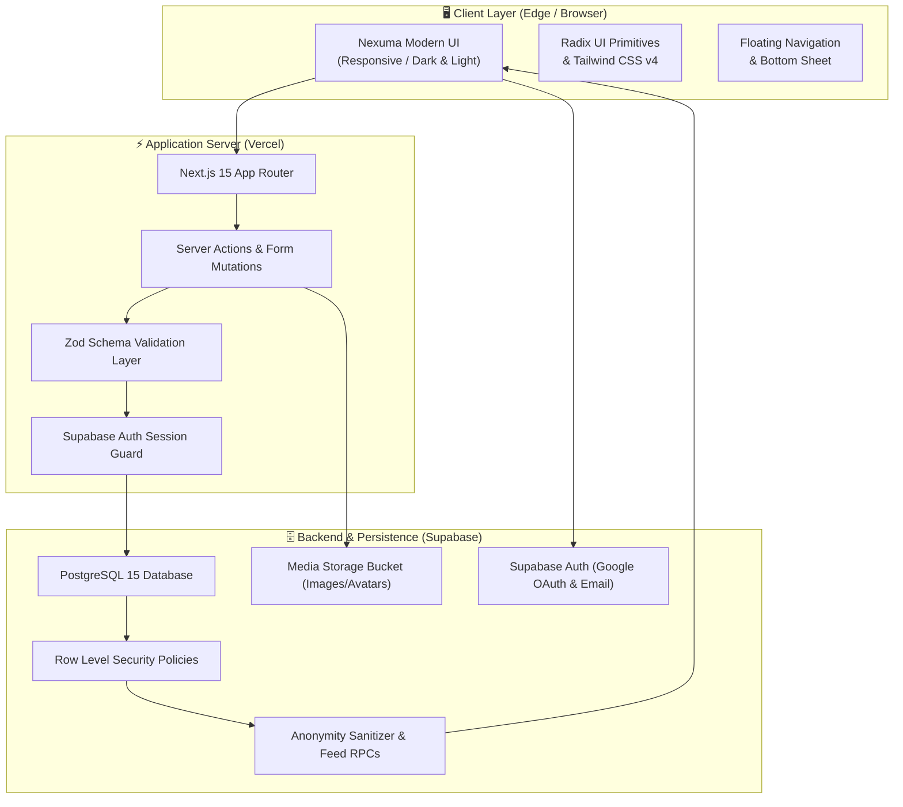

<div align="center">

# 🎓 Campusly
### *Your Campus. Your Stories. Your Voice.*

A modern, privacy-first university social network and confession ecosystem engineered for students across Pakistan.

[](https://campusly-ten.vercel.app/)
[](https://campusly-ten.vercel.app/)
[](https://github.com/ArifAli8866/campusly/actions)
[](https://github.com/ArifAli8866/campusly)

<br/>

[](https://nextjs.org/)
[](https://react.dev/)
[](https://www.typescriptlang.org/)
[](https://tailwindcss.com/)
[](https://supabase.com/)
[](LICENSE)

<br/>

[**Explore Live Website »**](https://campusly-ten.vercel.app/) &nbsp;•&nbsp; [**View GitHub Repository »**](https://github.com/ArifAli8866/campusly) &nbsp;•&nbsp; [**Report an Issue »**](https://github.com/ArifAli8866/campusly/issues)

</div>

---

## 📌 Table of Contents

- [📖 About Campusly](#-about-campusly)
- [✨ Key Features](#-key-features)
- [🔒 Privacy & Zero-Trace Anonymity](#-privacy--zero-trace-anonymity)
- [🏫 Supported Universities & Campuses](#-supported-universities--campuses)
- [🏛️ System Architecture](#-system-architecture)
- [🛠️ Tech Stack](#️-tech-stack)
- [🧪 Automated Testing & Security Verification](#-automated-testing--security-verification)
- [💻 Quickstart (Local Development)](#-quickstart-local-development)
- [🌐 Deployment](#-deployment)
- [👨‍💻 Author & Contact](#-author--contact)
- [📄 License](#-license)

---

## 📖 About Campusly

**Campusly** is a dedicated campus community platform designed to bridge the gap between open student dialogue and personal privacy. 

In university life, students often struggle to find safe, genuine outlets to express their struggles, seek honest academic guidance, or share campus experiences without fear of social judgment, peer pressure, or administrative repercussions. Traditional social networks mix unrelated audiences, while unofficial Facebook or Instagram confession pages suffer from zero moderation, vulnerability to doxxing, and lack of organized campus channels.

**Campusly reimagines student communication** by offering:
- **Localized Campuses**: Dedicated feeds and channels for individual universities and regional campuses across Pakistan.
- **True Anonymity by Design**: Anonymity enforced at the PostgreSQL database engine layer — not merely cosmetic front-end masking.
- **Student-Driven Topics**: Categorized community hubs spanning Confessions, Academics, Career & Internships, Campus Life, Hostels, and Lost & Found.
- **Safety & Moderation**: Built-in reporting pipelines, content triage, and anti-harassment safeguards to maintain healthy student dialogue.

> [!NOTE]
> **Campusly is live in production!** Experience the interactive platform today at [**campusly-ten.vercel.app**](https://campusly-ten.vercel.app/).

---

## ✨ Key Features

<table>
  <tr>
    <td width="50%">
      <h3>🕵️ Strict Cryptographic Anonymity</h3>
      <p>Post with complete peace of mind. Author credentials on anonymous confessions are stripped clean at the database query level before payloads ever touch the API or client network.</p>
    </td>
    <td width="50%">
      <h3>🏛️ Campus-Level Feeds</h3>
      <p>Dedicated spaces for each university and regional campus (Islamabad, Lahore, Karachi, Peshawar, etc.) ensuring campus news and discussions stay relevant to your specific campus.</p>
    </td>
  </tr>
  <tr>
    <td width="50%">
      <h3>💬 Dedicated Discussion Channels</h3>
      <p>Explore categorized feeds tailored for student life: <b>Confessions</b>, <b>Academics</b>, <b>Career Advice</b>, <b>Campus Life</b>, <b>Hostels & Housing</b>, and <b>Lost & Found</b>.</p>
    </td>
    <td width="50%">
      <h3>⚡ Real-Time Engagement</h3>
      <p>Vote on posts, participate in threaded comments, mention classmates with <code>@username</code> resolution, and save posts to your personal bookmarks.</p>
    </td>
  </tr>
  <tr>
    <td width="50%">
      <h3>🔍 Unified Global Fuzzy Search</h3>
      <p>Instantly search across universities, campuses, channels, discussions, confessions, and student profiles with instantaneous server-side query filtering.</p>
    </td>
    <td width="50%">
      <h3>🛡️ Community Moderation & Safety</h3>
      <p>Comprehensive moderation queue allowing student moderators to triage flags, prevent doxxing, hide harmful material, and enforce community standards.</p>
    </td>
  </tr>
  <tr>
    <td width="50%">
      <h3>🌓 Modern Nexuma UI/UX</h3>
      <p>Aesthetic design with floating pill navigation, dark/light theme switching, glassmorphic accents, fluid transitions, and mobile bottom sheet navigation.</p>
    </td>
    <td width="50%">
      <h3>🚀 Blazing Fast Next.js 15</h3>
      <p>Powered by React 19, Next.js Server Components, Turbopack, and Server Actions for zero client-side waterfalls and sub-second page loads.</p>
    </td>
  </tr>
</table>

---

## 🔒 Privacy & Zero-Trace Anonymity

Unlike typical social apps where anonymity is simply a client-side checkbox, **Campusly enforces privacy at the PostgreSQL database level**:

```
 ┌─────────────────┐       ┌──────────────────────┐       ┌──────────────────────┐
 │  Student Client │ ───►  │ Next.js App (Server) │ ───►  │ PostgreSQL Database  │
 │  (Browser UI)   │       │   (Server Actions)   │       │ (Row Level Security) │
 └─────────────────┘       └──────────────────────┘       └──────────┬───────────┘
          ▲                                                          │
          │         Sanitized Payload (Author Info = NULL)          │
          └──────────────────────────────────────────────────────────┘
```

1. **Zero Client Leakage**:
   When submitting an anonymous confession (`is_anonymous = true`), the author's user ID, username, and profile metadata are permanently masked by stored PostgreSQL RPC functions. Inspecting network payloads in browser DevTools reveals **zero identifying tokens**.
2. **Row-Level Security (RLS)**:
   Every query is safeguarded by strict PostgreSQL Row Level Security policies. Users can only modify or delete their own posts, comments, and profile settings.
3. **Emergency Deanonymization Audit Trail**:
   To prevent illegal behavior, threats, and doxxing while safeguarding student privacy, deanonymization is strictly locked behind an audited administrative function (`audit_deanonymise`) that logs the admin ID, exact timestamp, and safety rationale into an immutable audit table.

---

## 🏫 Supported Universities & Campuses

Campusly is tailored for premier higher-education institutes across Pakistan, with campus-specific routing:

| University | Regional Campuses | Discussion Hubs |
| :--- | :--- | :--- |
| **NUST** (National University of Sciences & Technology) | H-12 Islamabad, Rawalpindi, Risalpur, Karachi | Confessions, Academics, Hostels, Events |
| **FAST-NUCES** | Islamabad, Lahore, Karachi, Peshawar, Chiniot-Faisalabad | Tech Talk, Exam Stress, Career, Lost & Found |
| **LUMS** (Lahore University of Management Sciences) | Main Campus Lahore | Campus Life, Academics, Career, Housing |
| **IBA Karachi** | Main Campus, City Campus | Finance, Business, Student Life, Social |
| **COMSATS University** | Islamabad, Lahore, Abbottabad, Wah, Attock, Sahiwal, Vehari | Academics, Transport, Confessions, Tech |
| **UET Lahore** | Main Campus, Kala Shah Kaku, Faisalabad, Rachna | Engineering, Hostels, Societies, Admissions |
| **GIKI** (Ghulam Ishaq Khan Institute) | Topi Campus (Swabi) | Hostel Life, Engineering, Outdoor, Social |
| **PIEAS** | Islamabad Campus | Research, Academics, Campus Life |

> *...and expanding to more universities and colleges nationwide!*

---

## 🏛️ System Architecture



---

## 🛠️ Tech Stack

<div align="center">

| Layer | Technologies |
| :--- | :--- |
| **Frontend Framework** | [](https://nextjs.org/) [](https://react.dev/) |
| **Language** | [](https://www.typescriptlang.org/) |
| **Styling & Icons** | [](https://tailwindcss.com/) [](https://lucide.dev/) |
| **UI Primitives** | [](https://www.radix-ui.com/) [](https://sonner.emilkowal.ski/) |
| **Database & Auth** | [](https://supabase.com/) |
| **Schema Validation** | [](https://zod.dev/) |
| **Testing Suite** | [](https://vitest.dev/) [](https://pglite.dev/) |
| **Deployment** | [](https://vercel.com/) |

</div>

---

## 🧪 Automated Testing & Security Verification

Campusly includes automated testing covering unit functionality, validation schemas, token parsing, and PostgreSQL row-level security (RLS):

```bash
# Run the entire test suite (unit tests + security verification)
npm run test:all

# Run Vitest unit tests
npm test

# Run isolated database security smoke tests against embedded Postgres
npm run test:security

# Run code linter and TypeScript static analysis
npm run lint
npm run typecheck
```

The database smoke tests (`scripts/verify-security.mjs`) verify 37 distinct security invariants, including column privilege revocation on `author_id`, anonymized projection rules, and role-based access control.

---

## 💻 Quickstart (Local Development)

To run Campusly on your local machine:

### 1. Clone the repository
```bash
git clone https://github.com/ArifAli8866/campusly.git
cd campusly
```

### 2. Install dependencies
```bash
npm install
```

### 3. Set up environment variables
Create a `.env.local` file from the example:
```bash
cp .env.example .env.local
```

Configure your environment keys:
```env
NEXT_PUBLIC_SITE_URL=http://localhost:3000
NEXT_PUBLIC_SUPABASE_URL=https://your-supabase-project.supabase.co
NEXT_PUBLIC_SUPABASE_ANON_KEY=your-supabase-anon-key
SUPABASE_SERVICE_ROLE_KEY=your-supabase-service-role-key
```

### 4. Run the development server
```bash
npm run dev
```

Open [http://localhost:3000](http://localhost:3000) with your browser to explore the app.

---

## 🌐 Deployment

Campusly is deployed with continuous deployment on **Vercel** connected with **Supabase**.

- **Production Live URL**: [https://campusly-ten.vercel.app/](https://campusly-ten.vercel.app/)
- **Source Code Repository**: [https://github.com/ArifAli8866/campusly](https://github.com/ArifAli8866/campusly)

---

## 👨‍💻 Author & Contact

Developed with passion by **Arif Ali**:

- **GitHub**: [@ArifAli8866](https://github.com/ArifAli8866)
- **Repository**: [ArifAli8866/campusly](https://github.com/ArifAli8866/campusly)
- **Email**: [2arif2143055@gmail.com](mailto:2arif2143055@gmail.com)

⭐ **If you find this project helpful or inspiring, please give the repository a star on GitHub!**

---

## 📄 License

This project is open-source and licensed under the [MIT License](LICENSE).

<div align="center">
  <sub>Campusly &copy; 2026 • Built for Pakistani university students.</sub>
</div>
